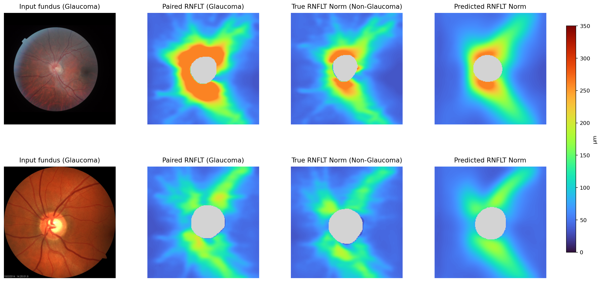

# Color Fundus-to-RNFLT Norm

The code for the paper entitled [**Deep Learning Prediction of Personalized Peripapillary Retinal Nerve Fiber Layer Thickness Norms from Fundus Images in Glaucoma**](https://pubmed.ncbi.nlm.nih.gov/42245038/). If you have any questions, please email harvardophai@gmail.com and harvardairobotics@gmail.com.

This repository predicts a **personalized healthy RNFLT-norm map** from a **color fundus** photograph (OS images are mirrored to an OD-like orientation). The companion [OCT en face](https://github.com/Harvard-AI-and-Robotics-Lab/Fundus2RNFLTNorm) release uses grayscale OCT fundus images.

## Requirements

Python 3.10  
pytorch >= 2.0  
torchvision >= 0.15  
numpy, pandas, pillow, matplotlib, tqdm

```bash
pip install -r requirements.txt
export PYTHONPATH="$PWD"
```

## Dataset

Sample color fundus images are provided at `image/fundus_1496028_1.png` and `image/fundus_9386127_0.png`. Here are sample codes to load one:

```python
from rnfltnorm.infer import load_fundus_rgb
import matplotlib.pyplot as plt

rgb = load_fundus_rgb("image/fundus_1496028_1.png")
plt.imshow(rgb)
plt.axis("off")
plt.show()
```

Training uses combined `fundusrnflt_*.npz` files with `colorfundus`, `rnflt_artifact_correct`, `pid`, and `glaucoma` (`0` healthy, `1` glaucoma, `2` suspect). The trainer keeps the earliest healthy exam per eye.

## Pretrained Model

The model weight `checkpoint_best.pt` and the training-set mean map `mean_rnflt.npz` are in `checkpoint/`.

## Use the Model

```python
from rnfltnorm.infer import load_predictor, load_fundus_rgb, prepare_fundus, predict_rnflt, plot_2dmap

rgb = load_fundus_rgb("image/fundus_1496028_1.png")
model, cfg, mean_np, device = load_predictor("checkpoint/checkpoint_best.pt")
fundus = prepare_fundus(rgb, cfg, flip=False, crop_retina=False)
pred, mask = predict_rnflt(model, fundus, mean_np, cfg, device)
plot_2dmap(pred, mask, title="Predicted RNFLT Norm")
```

A notebook version of this example is in `inference.ipynb`.

#### RNFLT prediction example:



Each row is one eye: input fundus (glaucoma), paired RNFLT (glaucoma), true RNFLT norm (non-glaucoma), predicted RNFLT norm. Thickness maps use a fixed 0–350 µm `turbo` scale.

## Acknowledgement and Citation

If you find this repository useful for your research, please consider citing our [paper](https://pubmed.ncbi.nlm.nih.gov/42245038/):

```bibtex
@article{yildiz2026rnfltnorm,
  title={Deep Learning Prediction of Personalized Peripapillary Retinal Nerve Fiber Layer Thickness Norms from Fundus Images in Glaucoma},
  author={Yildiz, Elif and Zha, Lucy and Zebardast, Nazlee and Shi, Min and Wang, Mengyu},
  journal={medRxiv},
  year={2026},
  doi={10.64898/2026.05.26.26354081},
  url={https://pubmed.ncbi.nlm.nih.gov/42245038/}
}
```
